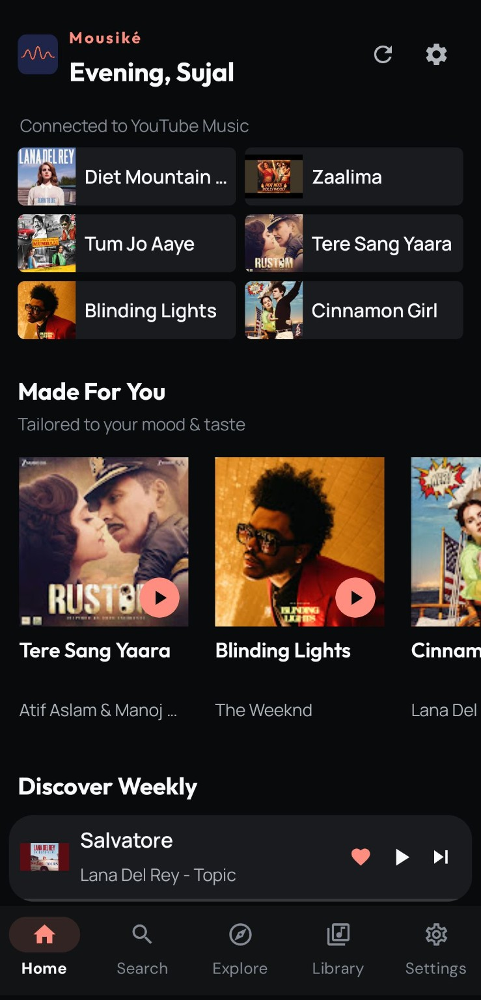
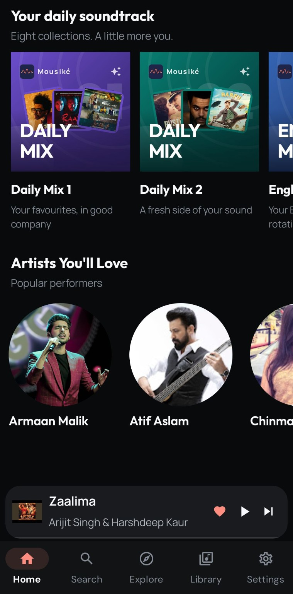
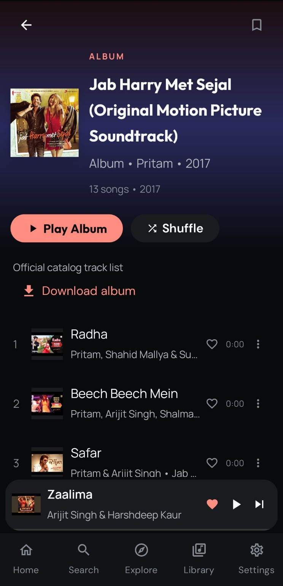
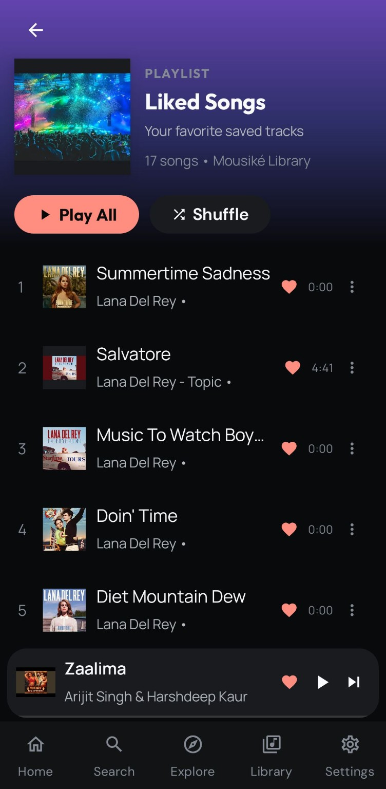
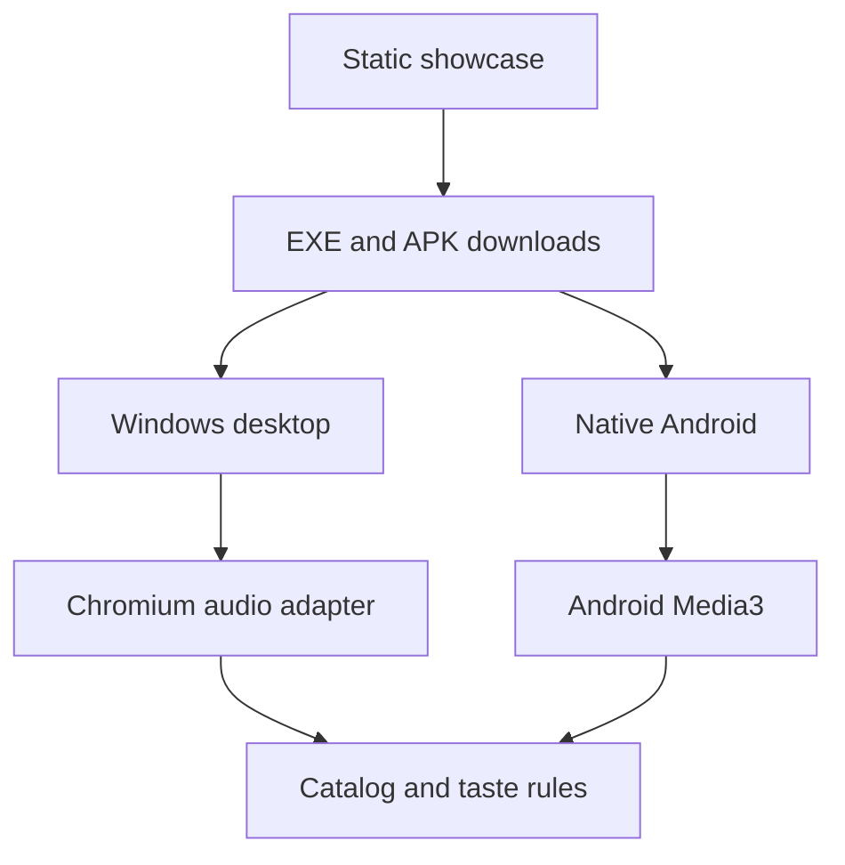

<div align="center">

<h1>Mousiké</h1>
<p><strong>Sound In motion.</strong> Your music. Your rhythm. Your space.</p>
<p>Windows desktop · Native Android · Responsive showcase website</p>
<p><a href="downloads/Mousike-3.6.0-Windows-x64-Setup.exe">Download Windows EXE</a> · <a href="downloads/Mousike-3.5.1-arm64.apk">Download Android APK</a> · <a href="index.html">Explore the website</a></p>
</div>

## A closer look — Windows

All four screenshots below are the supplied real desktop captures, included at full resolution. Click a screenshot to open it.

<table><tr>
<td width="50%"><a href="assets/screenshots/windows-home.png"></a><p align="center"><strong>Home & daily mixes</strong></p></td>
<td width="50%"><a href="assets/screenshots/windows-search.png"></a><p align="center"><strong>Music search</strong></p></td>
</tr><tr>
<td width="50%"><a href="assets/screenshots/windows-album.png"></a><p align="center"><strong>Album track list</strong></p></td>
<td width="50%"><a href="assets/screenshots/windows-settings.png"></a><p align="center"><strong>Appearance settings</strong></p></td>
</tr></table>

## Android experience

<table><tr>
<td width="25%"><p align="center">Home</p></td>
<td width="25%"><p align="center">Collections</p></td>
<td width="25%"><p align="center">Albums</p></td>
<td width="25%"><p align="center">Saved music</p></td>
</tr></table>

## What is included

| Folder / file | Purpose |
| --- | --- |
| `index.html` | Responsive showcase, real desktop and Android galleries, working EXE/APK download links |
| `main.html` | Matching alternate entry page |
| `assets/` | Original fonts, artwork, logo, developer photo, demo audio and all original screenshots plus four Windows screenshots |
| `downloads/` | Actual Windows 3.6.0 x64 installer and original Android APK |
| `mousike-sourcecode-windows/` | Complete Windows application source, package lockfile, tests, packaging scripts, CI recipe, licenses and architecture documentation |
| `mousike-sourcecode-android/` | Complete original Android source, retained unchanged |
| `docs/` | Installation, deployment, architecture, release notes and original documentation/graphics |

## Install and listen

**Windows 10 / 11 x64:** open `downloads/Mousike-3.6.0-Windows-x64-Setup.exe`, complete installation, and open Mousiké. It bundles Electron/Chromium, Node.js, yt-dlp and FFmpeg. No Android emulator, Python, Java or separate Node installation is required for users. This is an unsigned build. Windows preferences and downloads live in `%APPDATA%\Mousike`; uninstall retains personal data.

**Android 8+:** transfer the included ARM64 APK to your phone, open it and follow Android's installation prompts. The original filename is `Mousike-3.5.1-arm64.apk`; this package does not relabel or rebuild that binary. The Android source's declared version can differ from the supplied APK. See each platform's own source/build guide.

**Website:** open `index.html`, or serve the complete folder with `python -m http.server 8000` and visit `http://localhost:8000`. Keep the relative folder layout intact so images, fonts, audio and downloads resolve. Website player controls are a showcase/demo, not the installed application's streaming engine.

## Listening features

- Taste-aware Home, artist and album discovery, likes, playlists and listening activity.
- Daily Mix 01/02, English Mix, Bollywood Punch and additional personal collections; opening a mix builds its track list without autoplay.
- Expanded player, persistent mini-player, queue, shuffle, repeat, seek, volume, sleep timer and offline downloads.
- Super high, High and Low source selection; available source formats determine actual quality.
- Coral accents, square full-fit covers, themes, typography combinations, component layouts and reduced motion.
- Optional Gemini enhancement; local recommendations work without a key. Supply your own available model and API key.
- Developer portrait and links for **Sujal Wagholikar**: [GitHub](https://github.com/sujalwagholikar) · [Instagram](https://www.instagram.com/sujalwagholikar/).

## Architecture and platform boundary



The Windows edition carries over catalog, ranking, quality-selection and evidence-based album rules with desktop-specific implementations. It does not execute Android Media3 binaries. Android code and its playback engine were not modified for this bundle.

Long recordings over eight minutes can become album-like track lists when publisher chapters, timestamped descriptions or manual timings supply reliable boundaries. Missing evidence is reported rather than inventing song timings. Music and artwork availability depend on upstream services and network access.

## Build Windows from source

```powershell
cd mousike-sourcecode-windows
npm ci
npm run runtime
npm test
npm run bundle
npm start
```

Development requires Node.js 24. To build the EXE installer, install NSIS 3 and run:

```powershell
$env:MAKENSIS = 'C:\Program Files (x86)\NSIS\makensis.exe'
npm run dist:win
```

The application source and all app-specific assets are included. Compiled upstream runtimes and `node_modules` are restored using pinned dependencies/checksums; they are already bundled in the supplied EXE. See [Windows README](mousike-sourcecode-windows/README.md), [architecture](mousike-sourcecode-windows/docs/ARCHITECTURE.md), [platform parity](mousike-sourcecode-windows/docs/CORE_PARITY.md), [validation](mousike-sourcecode-windows/docs/VALIDATION.md) and [licenses](mousike-sourcecode-windows/THIRD_PARTY_NOTICES.md).

For Android build instructions, use [the Android project README](mousike-sourcecode-android/README.md) and its Gradle wrapper. Its files remain as supplied.

## Deployment and verification

See [deployment](docs/DEPLOYMENT.md) before uploading this bundle to GitHub or a website host. The Windows EXE exceeds GitHub's ordinary 100 MiB per-file limit: upload it as a GitHub Release asset or to suitable file storage, and update the site's links to that download URL. Do not attempt a normal Git commit of the EXE. The supplied local website links work when the complete folder is served by a host that supports these file sizes.

The prior Windows build passed 25 core/transport tests, browser audio/UI checks and installer archive integrity checks. Native Windows installation and live playback acceptance still require a Windows PC. This update checks packaging and website/README asset links; it does not claim a new Windows device test or instant playback guarantee.

All original supplied files are retained; README, index and alternate entry page are updated. New desktop source, screenshots, EXE and guides are added. No music-engine changes or binary rebuilds were made for this packaging update.
