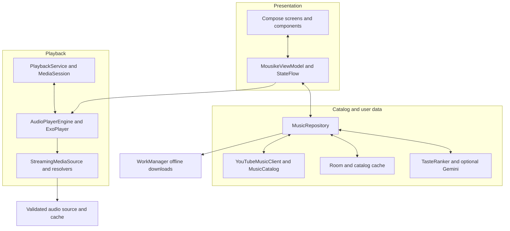
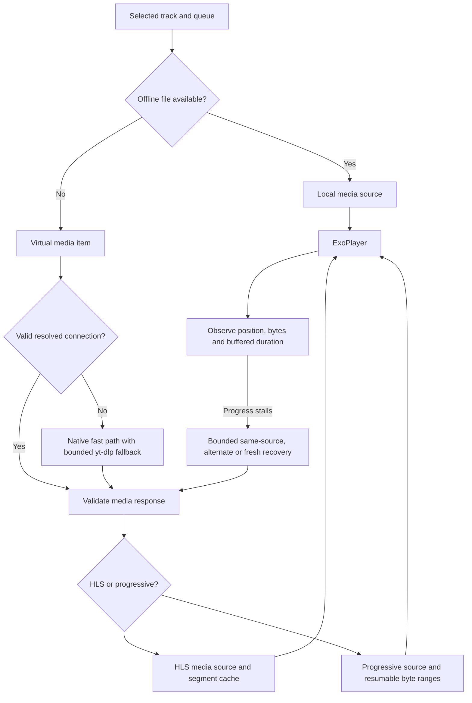
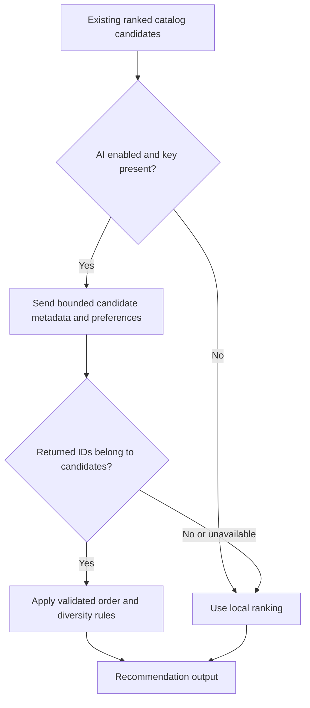
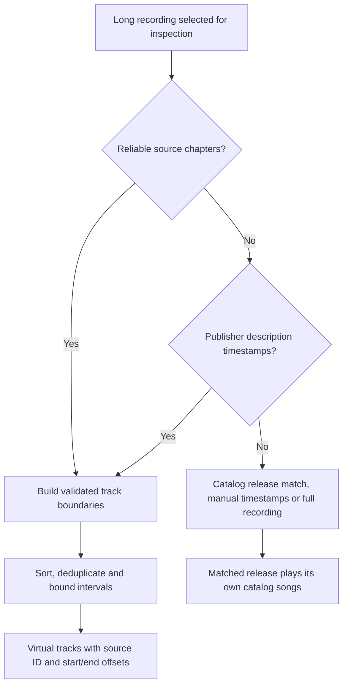

<!-- Original supplied README retained for historical reference; current release guidance is in ../README.md. -->
<div align="center">


<p>
  
  
  
  
  
</p>

**A personal soundtrack. A player that feels like you.**

Discover music, build your library and make the interface your own — with an independent native Android app built in Kotlin.

[Get the APK](#get-the-apk) · [Features](#the-experience) · [Architecture](#architecture) · [Build](#build-from-source) · [Developer](#developer)

</div>

---

> [!NOTE]
> This repository contains the **original Mousiké 3.6.0 application source**, including the corrected name and expanded personalised Home. It is a native Android project, not a website or a decompiled recovery. The supplied build is a signed development APK; the repository is not a Play Store listing.


## At a glance

<table>
<tr>
<td width="50%" valign="top">

### Music that follows your taste

A YouTube Music catalog, a local activity-aware ranker, personalised mixes and a larger Home collection. Optional Gemini can rerank existing music candidates when you supply a compatible API key and model.

</td>
<td width="50%" valign="top">

### An interface you can make yours

Coral and square covers by default. Six font combinations, multiple player and album layouts, theme presets, adjustable song rows and customisable navigation.

</td>
</tr>
<tr>
<td valign="top">

### Playback beyond the screen

Media3 playback, a background MediaSession service, Android notification controls, a queue, offline downloads and bounded recovery for stalled sources.

</td>
<td valign="top">

### A library that stays with you

Likes, playlists, listening history, saved albums and artists, feedback, catalog metadata and JSON library backup/restore. No app account is required.

</td>
</tr>
</table>

## Contents

- [Get the APK](#get-the-apk)
- [The experience](#the-experience)
- [How the app works](#how-the-app-works)
- [Architecture](#architecture)
- [Playback, resolution and recovery](#playback-resolution-and-recovery)
- [How recommendations work](#how-recommendations-work)
- [How long recordings become track lists](#how-long-recordings-become-track-lists)
- [Appearance and typography](#appearance-and-typography)
- [Data, privacy and network boundaries](#data-privacy-and-network-boundaries)
- [Build from source](#build-from-source)
- [Repository map](#repository-map)
- [Validation and troubleshooting](#validation-and-troubleshooting)
- [Contributing and credits](#contributing-and-credits)
- [Developer](#developer)

## Get the APK

### Build it with GitHub Actions

1. Upload the extracted project contents to your repository root. The root must contain `app/`, `gradlew`, `gradle/` and `.github/`.
2. Open **Actions → Build Mousike APK**. Enable Actions if GitHub asks.
3. Open a successful run and download **Mousike-3.6.0-APKs** from its Artifacts section.
4. Extract the artifact and install **`app-arm64-v8a-debug.apk`** on an arm64 phone, including the Moto G54.

The [included workflow](.github/workflows/android.yml) builds on pushes to `main`/`master`, pull requests and manual runs. It uploads APK artifacts; it does not automatically create a public release. See [GITHUB_SETUP.md](GITHUB_SETUP.md) for upload commands and repository setup.

| App identity | Value |
| --- | --- |
| Display name | **Mousiké** |
| Tagline | **Sound In motion** |
| Version / code | **3.6.0 / 360** |
| Supplied debug package | `com.mousike.app.fast` |
| Minimum Android version | Android 8.0 / API 26 |
| Compile and target SDK | API 35 |
| APK splits | `arm64-v8a`, `x86_64` |

Install over the matching previously supplied app to retain its local data. The project retains the same public development signing key. A differently signed APK cannot update the existing installation directly.

## The experience

| Area | Available features |
| --- | --- |
| **Home** | Made For You, discovery songs, eight personal collection templates, artists, activity-aware album shelves and Heavy Rotation |
| **Expanded discovery** | Up to **60 personalised songs**, **48 discovery songs** and **96 albums across three shelves of 32**, subject to real catalog availability |
| **Search** | Text search and public YouTube video links; songs, artists and albums; recent searches and real error/empty states |
| **Albums and artists** | Open a release to its track list, save albums/artists, browse artist tracks and select a song explicitly |
| **Full player** | Seek, pause/resume, previous/next, shuffle/repeat, likes, lyrics, queue, downloads, equalizer and sleep timer |
| **Background audio** | Foreground media playback service, MediaSession transport controls and an expanded-player destination from notifications |
| **Library** | Likes, user playlists, saved releases/artists, listening history and JSON library export/import |
| **Downloads** | App-private offline audio, WorkManager jobs, progress/cancellation and Wi-Fi-only preference |
| **Personalisation** | Name, artists, languages, genres, discovery balance, activity feedback and optional Gemini reranking |
| **Appearance** | Five theme modes, seven accents, six font combinations, three cover shapes, density and text sizing |
| **Components** | Player layouts, cover size/background, album presentation, row spacing, mini-player style and navigation label visibility |
| **Display** | Reduced motion and supported refresh-rate choices up to 120 Hz; Android and the device determine the actual rate |

**Real content, bounded collections.** Home limits are capacities, not a promise of fabricated entries. Results depend on available public catalog metadata, the cached library and your listening taste. A small or unavailable upstream catalog can produce smaller shelves.

## How the app works

<details open>
<summary><strong>01 · Start, choose your taste and arrive at Home</strong></summary>

The app reads its persisted preferences and cached catalog, then presents onboarding when needed. Languages, genres and favourite artists seed discovery. Preparation screens provide the transition into the app; they do not train a model. Existing library data can appear before a remote refresh completes.

`MainActivity` hosts the Compose interface. `MousikeViewModel` exposes screen state through StateFlow and coordinates repository work. Home is built with lazy lists so a larger catalog does not require every cover or row to be composed at once.

</details>

<details>
<summary><strong>02 · Discover and open a release</strong></summary>

`YouTubeMusicClient` queries the anonymous music catalog and parses song, album and artist renderers. `MusicRepository` registers normalised results in `MusicCatalog` and schedules durable metadata caching. Music-first ordering prefers official audio/album recordings, then official music videos, without replacing an explicitly tapped video ID.

Album browsing resolves the release's catalog track list. Opening an album or building a personal mix displays its songs; playback is a separate user action. Artist pages resolve their own catalog information. Album browsing preserves source track order.

</details>

<details>
<summary><strong>03 · Tap a song and hand control to the player</strong></summary>

The UI submits the selected track and queue context to `AudioPlayerEngine`. A downloaded local file is preferred when available. A remote item uses the app's virtual media URI; the source resolves its audio connection on worker threads before choosing the correct progressive/HLS parser. The selected track's metadata and queue stay separate from temporary signed stream URLs.

</details>

<details>
<summary><strong>04 · Keep listening and shape what comes next</strong></summary>

The engine and background service track listening outcomes. Likes, completed listening, skips and explicit feedback feed the local ranker. The existing Play Next/radio logic uses ranked candidates and optional Gemini enrichment. Home separately refreshes its larger presentation from activity signals and cached metadata.

</details>

<details>
<summary><strong>05 · Save, download or personalise</strong></summary>

Room stores library actions and activity. Offline requests become unique WorkManager jobs, while preference changes are persisted locally and exposed to Compose. Appearance updates do not rewrite the playback engine. The streaming quality preference applies at the next media-item transition, leaving the current song alone.

</details>

## Architecture

Mousiké separates presentation, catalog/library work and audio playback. The UI does not scrape a watch page or run FFmpeg on the main thread.



### Component responsibilities

| Component | Owns | Important boundary |
| --- | --- | --- |
| [`MainActivity`](app/src/main/java/com/mousike/app/MainActivity.kt) | Compose host, navigation integration and system/display handling | Activity lifecycle is separate from background playback |
| [`MousikeViewModel`](app/src/main/java/com/mousike/app/ui/viewmodel/MousikeViewModel.kt) | Screen StateFlows, selection, user commands and task coordination | Delegates audio operations to the engine |
| [`MusicRepository`](app/src/main/java/com/mousike/app/data/repository/MusicRepository.kt) | Catalog registration, library operations, recommendations and album resolution | Catalog metadata is not a permanent playable URL |
| [`YouTubeMusicClient`](app/src/main/java/com/mousike/app/data/remote/YouTubeMusicClient.kt) | Anonymous music catalog requests, parsing and bounded pagination | Does not own the player |
| [`MusicCatalog`](app/src/main/java/com/mousike/app/data/catalog/MusicCatalog.kt) | Normalised in-memory tracks, albums and artists | Revision signals allow consumers to refresh |
| [`CatalogCache`](app/src/main/java/com/mousike/app/data/catalog/CatalogCache.kt) | Atomic durable metadata snapshots | Expiring signed audio URLs are excluded |
| [`AudioPlayerEngine`](app/src/main/java/com/mousike/app/playback/AudioPlayerEngine.kt) | ExoPlayer, queue, controls, audio focus, progress and recovery coordination | Player ownership stays on its main-thread scope |
| [`StreamingMediaSource`](app/src/main/java/com/mousike/app/playback/StreamingMediaSource.kt) | Virtual-to-real media resolution and parser selection | HLS is identified before a progressive parser is chosen |
| [`NativeAudioResolver`](app/src/main/java/com/mousike/app/playback/NativeAudioResolver.kt) | Existing fast native audio candidate path | Format metadata must still pass stream validation |
| [`YtDlpExtractor`](app/src/main/java/com/mousike/app/playback/YtDlpExtractor.kt) | Bounded fallback extraction, metadata and connection preparation | Python/JS work stays outside UI rendering |
| [`StreamVerifier`](app/src/main/java/com/mousike/app/playback/StreamVerifier.kt) | Bounded prefix/container/manifest checks | A successful HTTP status is not proof of playable audio |
| [`ResumingAudioDataSource`](app/src/main/java/com/mousike/app/playback/ResumingAudioDataSource.kt) | Progressive byte-range continuation and response validation | Keeps transport repair separate from UI state |
| [`PlaybackService`](app/src/main/java/com/mousike/app/playback/PlaybackService.kt) | MediaSession, notification lifecycle and background signals | Android controls the system media-player presentation |
| [`BufferingWatchdog`](app/src/main/java/com/mousike/app/performance/BufferingWatchdog.kt) | Progress-aware stall decisions and a continuous wait deadline | Observes state; it does not invent playable sources |
| [`DownloadStore`](app/src/main/java/com/mousike/app/download/DownloadStore.kt) | Download entries, files and unique worker requests | Downloaded audio uses app-private storage |
| [`AppSettings`](app/src/main/java/com/mousike/app/settings/AppSettings.kt) | Preferences and encrypted optional API-key access | Secrets are separate from ordinary preferences |

## Playback, resolution and recovery

### Connection lifecycle



1. **Select:** a tap identifies a specific song and queue. The app does not conduct a new semantic search to substitute a different recording during playback.
2. **Resolve:** cached connections can be reused while valid. Otherwise the established native resolver runs first, with the existing bounded yt-dlp fallback. yt-dlp uses the bundled Python/QuickJS challenge runtime when required.
3. **Verify:** source responses are checked before acceptance. HTML, JSON error pages and invalid media/playlist prefixes are rejected.
4. **Prepare:** source type determines the media parser. HLS segments do not reuse one progressive-file cache key.
5. **Play:** Media3 handles decoding, audio focus, output changes, clipping and transport state. The MediaSession exposes system controls.
6. **Recover:** the watchdog samples actual position, buffer and transferred-byte progress. Healthy index downloads can therefore count as progress even while buffered duration remains zero. Recovery is bounded rather than an unlimited loading loop.

A stalled prepared source can receive a same-source soft rebuild before alternate/fresh selection. The engine retains its established deadlines and retry policy. This mechanism improves resilience; network/CDN/source availability still determines whether a track can play.

### Audio quality

| Setting | Source-selection preference | When it applies |
| --- | --- | --- |
| **Super high** | Highest available original/default audio; no requested bitrate ceiling | Next song / media-item transition |
| **High** | Target up to 160 kbps, retaining the established AAC preference | Next song / media-item transition |
| **Low** | Target up to 64 kbps; use the lowest available source when necessary | Next song / media-item transition |

[`AudioQualityPolicy`](app/src/main/java/com/mousike/app/settings/AudioQualityPolicy.kt) supplies native/yt-dlp choices. [`QualitySelectionBinding`](app/src/main/java/com/mousike/app/settings/QualitySelectionBinding.kt) applies Media3 audio constraints at transitions. Formats depend on the source; compatibility/recovery fallbacks can differ from the requested target. These labels do not promise lossless audio, a guaranteed bitrate or a premium service tier. Existing downloads are not re-encoded when this preference changes.

### Background playback

`PlaybackService` owns a MediaSession connected to the existing ExoPlayer. Android supplies the notification/lock-screen presentation using track metadata and supported session commands. A notification tap opens the expanded player. Audio focus, headphone disconnection handling and the foreground media playback service remain part of the native implementation.

### Offline downloads

`DownloadStore` enqueues unique WorkManager jobs. `MusicDownloadWorker` resolves/downloads audio through yt-dlp and uses FFmpeg support for section-based work when necessary. Progress is persisted and surfaced to the UI; cancellation can stop extraction. The default unmetered-network constraint respects Wi-Fi-only downloads. Download processing is distinct from the normal streaming path — FFmpeg initialisation is not required for every play tap.

## How recommendations work

### Local ranking is the foundation

[`TasteRanker`](app/src/main/java/com/mousike/app/recommendation/TasteRanker.kt) uses the available catalog and the listener's activity. It combines:

- Preferred artists, genres and languages.
- Positive signals from likes, meaningful listening and explicit “more like this” feedback.
- Negative signals from early skips, “not interested”, “don't recommend” and artist suppression.
- Longer-term and recent listening context, with time decay.
- Token and character-ngram metadata similarity.
- Current-track context for next-song flow.
- Novelty/exploration, recent-repeat penalties, canonical duplicate handling and artist diversity.

This is an implemented **local content-based ranker**. The repository does not contain a trained multilingual embedding service or Spotify-scale collaborative recommendation dataset.

### Larger Home collections

[`HomeFeedSelection`](app/src/main/java/com/mousike/app/recommendation/HomeFeed.kt) is a Home presentation layer. It uses taste-ranked songs to organise up to 60 personalised songs, 48 discovery songs and 96 albums. Album scores consider artist affinity, explicitly preferred artists, matching track membership, genre and a small daily rotation term. A varied first pass limits one artist's dominance before the rest of the collection fills in.

The repository expands Home metadata using taste-based song/album queries in batches of two. Requests have bounded pagination, cached successful pages, a single-flight lock and a 15-minute cooldown. Home and playback do not await that expansion. Cached selections can be re-ranked on activity during the cooldown; the cooldown controls network expansion, not whether the listener's taste can influence ordering.

### Optional Gemini enrichment



[`GeminiRecommender`](app/src/main/java/com/mousike/app/recommendation/GeminiRecommender.kt) sends at most 40 candidate records for reranking, caches compatible results and rate limits requests. The app accepts IDs from its supplied candidate set, rather than arbitrary model-generated playback URLs. Missing keys, unavailable models, quota errors and invalid responses fall back to local candidates.

Enter your own key and a model available to that key under **Settings → AI recommendations**. The validation action checks the selected model against the API's model list. No personal key is compiled into this source. The stored default model string is configuration, not a guarantee of current model availability or free API access.

## How long recordings become track lists

[`AlbumDetector`](app/src/main/java/com/mousike/app/album/AlbumDetector.kt) treats a recording longer than **8 minutes** as a candidate for inspection when the preference is enabled. Length alone does not prove it is an album.



Boundaries are sorted and deduplicated, constrained to recording duration and checked for meaningful interval lengths. A virtual track retains the source video ID plus explicit start/end milliseconds; Media3 clipping makes its seek position and duration relative to that segment.

If neither source chapters nor trustworthy description timings exist, the app does **not** fabricate song offsets. It can offer a plausible catalog release, accept a pasted timestamped list or play the full recording. A release match plays that release's own catalog tracks and is distinct from verified segmentation of the original source. No Whisper/ASR transcription engine is bundled for automatic audio-only segmentation.

## Appearance and typography

<table>
<tr><td width="50%" valign="top">

### Choose an atmosphere

**Themes:** Midnight · AMOLED · Light · Warm · System  
**Accents:** Coral · Green · Lavender · Sky · Rose · Amber · Mint  
**Presets:** Signature · Studio · Afterhours · Editorial  
**Cover shapes:** Square · Rounded · Soft

</td><td width="50%" valign="top">

### Shape the components

**Player:** Classic · Immersive · Compact  
**Albums:** Editorial · Gallery · Compact  
**Mini player:** Floating · Edge  
**Controls:** artwork size, background, button colour, context, shortcuts, row spacing, progress and navigation labels

</td></tr>
</table>

| Font combination | Headings | Reading | Controls |
| --- | --- | --- | --- |
| **Signature** | Manrope | Inter | Roboto |
| **Modern** | Outfit | DM Sans | Inter |
| **Editorial** | Lora | Inter | Roboto |
| **Studio** | Plus Jakarta Sans | Roboto | Inter |
| **Minimal** | Inter | Inter | Roboto |
| **Expressive** | Outfit | Manrope | DM Sans |

The seven families and their licence notices are bundled. Changing fonts does not require an external font request. [`MousikeTheme`](app/src/main/java/com/mousike/app/ui/theme/Theme.kt) provides the palette, text scale and selected font roles; explicit heading/body/control styles follow those roles too.

Artwork uses full-image fitting rather than cropping. Album/track covers share shape helpers, while artist portraits keep their circular presentation. Reduced-motion controls remain available; refresh-rate preferences cannot exceed the device's supported display modes or override Android power policy.

The upgrade applied coral and square covers once. Subsequent choices persist. **Restore coral & square defaults** resets presentation while retaining taste, quality and library data. The full data-reset action is separate and asks for confirmation. See the [customisation guide](docs/CUSTOMISATION.md).

## Data, privacy and network boundaries

| Information | Storage / destination | Purpose |
| --- | --- | --- |
| Likes, playlists, saved albums/artists, searches and activity | App-local Room database | Library and local personalisation |
| Catalog metadata and chapter offsets | In-memory registry and atomic catalog file | Browse continuity and virtual-track identity |
| Queue state | App-local preferences | Playback state persistence |
| UI/taste/quality choices | App-local preferences exposed as StateFlow | Settings and presentation |
| Optional Gemini API key | Encrypted local secret using a non-exportable Android Keystore key | User-enabled API access |
| Downloaded audio | App-private files | Offline playback |
| Temporary signed media connections | In-memory resolution state; not durable catalog backup fields | Active streaming |
| Search/catalog requests and audio connections | YouTube Music / YouTube and source CDN endpoints | Catalog lookup and playback |
| Selected candidate music metadata and preferences | Google Gemini API, only when enabled/configured | Optional reranking |

The app does not require a Mousiké account. This does not make network use anonymous to upstream services: those services still receive the requests sent to them. Library JSON export/import covers library metadata; it is not an export of the encrypted API key or downloaded audio files. Android app backup is disabled in the supplied manifest.

## Build from source

### Toolchain

| Component | Pinned / required value |
| --- | --- |
| Java | Complete **JDK 17** |
| Gradle wrapper | 8.13 |
| Android Gradle Plugin | 8.13.0 |
| Kotlin | 2.1.20 |
| Compose BOM | 2025.04.01 |
| Android platform / Build Tools | 35 / 35.0.0 |
| Media3 | 1.8.0 |
| yt-dlp resource | 2026.10.21 |
| Android yt-dlp / FFmpeg wrapper dependencies | 0.18.1 |

1. Open the extracted repository root — the directory containing `settings.gradle.kts` — in Android Studio.
2. Install SDK Platform 35 and Build Tools 35.0.0. Select **JDK 17** as the Gradle JVM.
3. Allow Gradle sync to download the pinned dependencies.
4. Build the debug APKs with the command for your operating system.

**Windows / PowerShell**

```powershell
.\gradlew.bat :app:assembleDebug
```

**Linux / macOS**

```bash
chmod +x gradlew
./gradlew :app:assembleDebug
```

Output: `app/build/outputs/apk/debug/app-arm64-v8a-debug.apk` and the x86_64 split. The first build needs internet access. `local.properties` is intentionally excluded because your SDK path is machine-specific. The project bundles its own app resources and runtime inputs, while Gradle fetches third-party Android dependencies; it is not an entirely offline vendor mirror of upstream source.

<details>
<summary><strong>Development signing and update continuity</strong></summary>

The supplied debug build uses `signing/mousike-development.keystore`. Its public development credentials are documented in [signing/README.md](signing/README.md). The Git ignore rules deliberately keep this one development key, so GitHub builds do not silently switch update identities or fail because it is missing.

This public development key is not a private production identity. A separately distributed production release should use its own privately managed signing configuration. Do not commit a private release key or a personal Gemini API key. Signing changes can affect whether a future APK can update an installed build.

</details>

## Repository map

Paths below are relative to the repository root.

| Path | Contents |
| --- | --- |
| `app/src/main/java/com/mousike/app/` | Original Kotlin application source |
| `…/ui/screens/` | Home, Search, Explore, Library, Settings, player, albums, artists and supporting screens |
| `…/ui/components/` | Reusable cards, mini player, navigation, mixes, artwork and motion components |
| `…/ui/theme/` | Palettes, font-role combinations, typography and shape/preset helpers |
| `…/ui/viewmodel/` | UI state and application interaction coordination |
| `…/playback/` | Media3 engine, resolution, verification, caching, transport and background service |
| `…/performance/` | Cancellation, connection work, bounded resolution, progress and buffering guards |
| `…/data/local/` | Room entities, DAO and database |
| `…/data/remote/` | Music catalog and lyrics clients; music-first candidate preference |
| `…/data/catalog/` | In-memory registry, metadata cache and original demo catalog |
| `…/data/model/` | Track/album/player models and backup-safe track codec |
| `…/data/repository/` | Catalog, library, discovery and album-resolution orchestration |
| `…/recommendation/` | Local taste ranker, optional Gemini and larger Home selection |
| `…/album/` | Evidence-based long-recording track detection |
| `…/settings/` | Persistent preferences, key encryption and quality adapter |
| `…/download/` | Download store and WorkManager worker |
| `app/src/main/res/` | Fonts, icons, portrait, UI resources and bundled yt-dlp resource |
| `app/src/main/assets/` | Original demo audio/art, source logo assets and font notices |
| `app/src/main/jniLibs/` | Supplied native shared runtime inputs |
| `app/src/test/` / `app/src/androidTest/` | JVM/Robolectric and Android instrumentation test source |
| `gradle/wrapper/` | Versioned Gradle wrapper JAR/configuration |
| `.github/workflows/android.yml` | APK build and workflow-artifact upload |
| `docs/` / `validation/` | Guides, historical evidence, current reports and source-comparison records |
| `docs/readme/` | GitHub graphics, original logo copy and base64-embedded SVG logo |

## Validation and troubleshooting

### What was checked

The corrected Home build completed successfully. **Four focused Home feed tests** cover bulk limits/deduplication, activity-driven album ordering, artist diversity and sparse/offline catalogs. Package/version/name/signature checks and comparisons confirmed preservation of the preceding build's playback/settings/runtime inputs.

The earlier 3.6.0 update had **32 focused checks** for quality, preference persistence, source stability and buffering recovery. Those are historical results for that stage; they were not all repeated for the small name/Home correction. Physical-device playback, current network catalog volume and GitHub-hosted workflow execution were not newly certified by the documentation update.

See [TEST_REPORT.md](TEST_REPORT.md) and [validation/changes-home-correction.json](validation/changes-home-correction.json) for the actual scope. A passing unit suite is not a guarantee of upstream source availability or zero buffering on every connection.

**Home selection checks**

```bash
./gradlew :app:testDebugUnitTest --tests '*HomeFeedTest'
```

**Selected playback/settings regression checks**

```bash
./gradlew :app:testDebugUnitTest --tests '*QualityAndMusicPreferenceTest' --tests '*AppearancePersistenceTest' --tests '*Stability34Test' --tests '*BufferingWatchdogTest'
```

<details>
<summary><strong>Build cannot find Java or reports a class-version mismatch</strong></summary>

Use a complete JDK 17, not a JRE-only installation. In Android Studio, set the Gradle JVM explicitly. In a terminal, check `java -version` and `./gradlew --version` (Windows: `.\gradlew.bat --version`) to confirm that Gradle is using the intended Java installation. Use the wrapper included with this repository.

</details>

<details>
<summary><strong>GitHub build cannot find the signing key or Gradle project</strong></summary>

Verify that the repository root contains `gradlew`, `settings.gradle.kts`, `app/`, `.github/workflows/android.yml` and `signing/mousike-development.keystore`. Do not upload only the outer ZIP or omit hidden GitHub configuration. The supplied `.gitignore` includes an exception for the public development key.

</details>

<details>
<summary><strong>Albums are fewer than the Home limit</strong></summary>

The limit is not a generated-content target. Existing data appears first; taste-based metadata expansion runs in the background and is throttled. Add favourite artists, listen, like songs and return to Home. Source availability, network access, cache contents and the cooldown determine when additional releases become available. The app does not fabricate album entries to fill the shelf.

</details>

<details>
<summary><strong>A song buffers or cannot connect</strong></summary>

Check the network and try another source. Catalog visibility does not guarantee that a playable media URL is available from that network or region. The existing engine validates connections and performs bounded recovery. Playback diagnostics under About & support can help describe the device/source failure; include version, Android/device details and whether the issue affects one song or every song when reporting it.

</details>

<details>
<summary><strong>Optional AI is unavailable</strong></summary>

Music discovery still uses local ranking. Check the key/model validation status and choose a model actually available to your key. Upstream quota, billing and model availability are outside the app's control. Do not include API keys in screenshots, issues or source commits.

</details>

## Contributing and credits

Use the existing package boundaries when making changes. Presentation changes belong in `ui/` and theme settings; catalog changes belong in the data layer. Keep playback lifecycle and transport changes scoped, documented and covered by relevant regression checks. Describe the trigger, resulting behaviour and validation in pull requests.

### Issue report template

```text
App version:
Phone / Android version:
Area: playback / catalog / Home / appearance / downloads / build
Steps to reproduce:
Expected result:
Actual result:
One source or all sources affected:
Relevant redacted diagnostics:
```

### Pull request template

```text
Problem:
Change:
Affected components:
Validation performed:
Device/network validation, if applicable:
```

### Documentation and upstream projects

- [GitHub setup](GITHUB_SETUP.md) · [Architecture notes](docs/ARCHITECTURE.md) · [Customisation](docs/CUSTOMISATION.md)
- [Release notes](RELEASE_NOTES_3.6.0.md) · [Validation](TEST_REPORT.md) · [Performance scope](PERFORMANCE_REPORT.md)
- [Third-party notices](THIRD_PARTY_NOTICES.md) · [Development signing](signing/README.md) · [GPL-3.0 licence](LICENSE)
- [AndroidX / Media3](https://developer.android.com/media/media3) · [Jetpack Compose](https://developer.android.com/compose)
- [yt-dlp](https://github.com/yt-dlp/yt-dlp) · [Android yt-dlp wrapper](https://github.com/yausername/youtubedl-android) · [FFmpeg](https://ffmpeg.org/)
- [OkHttp](https://github.com/square/okhttp) · [Coil](https://github.com/coil-kt/coil) · [Google Fonts](https://github.com/google/fonts)

The app source is distributed under [GPL-3.0](LICENSE). Keep component-specific notices and font licences with redistributed source/builds. Music and artwork belong to their respective owners; Mousiké is independent and is not affiliated with Spotify or YouTube. Original bundled sound-check audio is provided for the app's demo path, not as a commercial music catalog.

## Developer

<table>
<tr>
<td width="150" align="center">

</td>
<td valign="middle">

### Sujal Wagholikar

Design & development of **Mousiké**.

[GitHub — sujalwagholikar](https://github.com/sujalwagholikar)  
[Instagram — @sujalwagholikar](https://www.instagram.com/sujalwagholikar/)

</td>
</tr>
</table>

<details>
<summary><strong>Brand assets and encoded logo</strong></summary>

The original app logo is copied to [`docs/readme/logo.png`](docs/readme/logo.png). [`docs/readme/logo-embedded.svg`](docs/readme/logo-embedded.svg) embeds that exact PNG as a base64 data URI inside an SVG; [`hero.svg`](docs/readme/hero.svg) does the same for the banner. The README displays PNG renderings for broad GitHub/image-proxy compatibility, rather than relying on inline base64 Markdown images. Upload `docs/readme/` together with this README so its graphics resolve.

The rendered panels are documentation graphics, not fabricated app screenshots. Mermaid diagrams describe the implemented source boundaries and flows. Optional external badges show static project labels; they are not live CI pass indicators.

</details>

---

<div align="center">


**Mousiké · Sound In motion**  
Built by [Sujal Wagholikar](https://github.com/sujalwagholikar)
</div>
