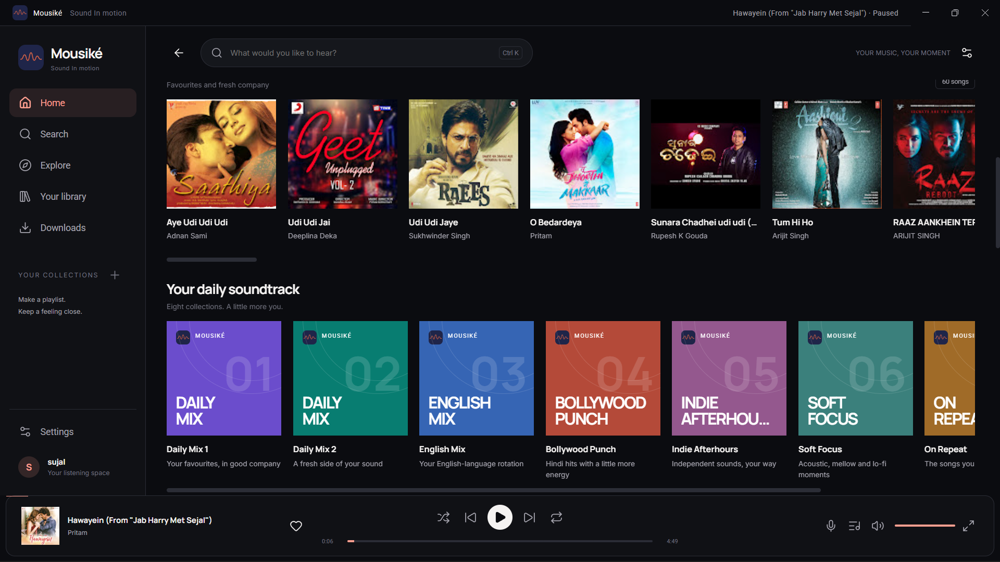
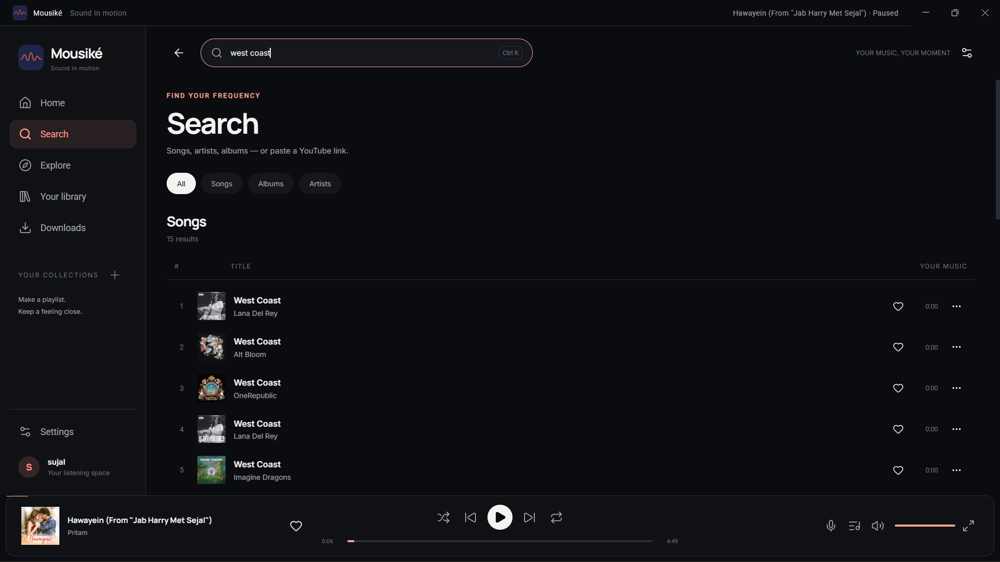
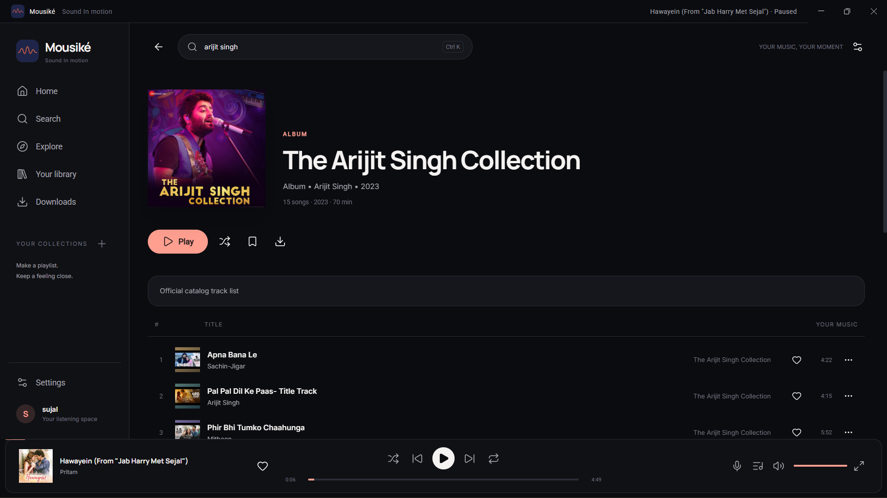
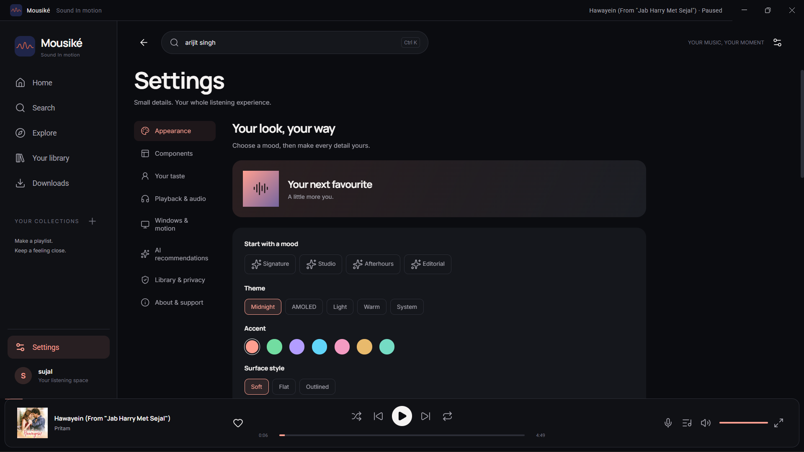

<div align="center">
  
  <h1>Mousiké for Windows</h1>
  <p><strong>Sound In motion.</strong></p>
  <p>A personal music space, reimagined for your desktop.</p>
  <p>  </p>
  <p>Created by <a href="https://github.com/sujalwagholikar">Sujal Wagholikar</a> · <a href="https://www.instagram.com/sujalwagholikar/">Instagram</a></p>
</div>

---

> **Desktop adaptation of Mousiké 3.6.0.** The supplied Android source and APK
> were left unchanged. Android's Media3 runtime cannot run on Windows; this
> edition translates its catalog, taste, quality and timestamp rules and uses
> a Chromium/Hls.js audio adapter. See [core parity](docs/CORE_PARITY.md).

## Get started

| Distribution | Open it this way |
| --- | --- |
| `Mousike-3.6.0-Windows-x64-Setup.exe` | Run the installer, choose a folder and open **Mousiké** |
| `Mousike-3.6.0-Windows-x64-Portable.zip` | Extract **all** files and run `Mousike.exe` in that folder |
| Source ZIP | Unzip and follow the development instructions below |

Requires **64-bit Windows 10 or Windows 11**. The application bundles its own
Electron/Chromium, Node.js, yt-dlp, FFmpeg and fonts. End users do not need an
Android emulator, Java, Python or a separate Node.js installation.
This is an unsigned build, without a trusted publisher certificate.

Choose your listening languages, sounds and optional favourite artists on
first open. Search for music or paste a YouTube Music song link. Opening an
album displays its tracks. Opening a daily mix builds a collection without
starting music. The first catalog refresh needs internet access.

For a network-independent check, use **Settings → About & support → Offline
sound check**. It adds three original instrumentals with real playable WAV
files. These fixtures are never disguised as online catalog results.

## A familiar listening space

| Area | Included behavior |
| --- | --- |
| Desktop shell | Persistent sidebar, keyboard search, wide content, adaptive laptop layout, native window controls |
| Home | Up to 60 ranked songs, 48 discoveries and 96 albums from the actual available catalog; activity and daily rotation change ordering |
| Mixes | Daily Mix 01/02, English, Bollywood, Indie, Chill, On Repeat and Discovery; artist diversity, real song lists, no automatic playback on build |
| Music library | Likes, playlists, saved albums/artists, listening history, feedback, Android-compatible library backup/import |
| Player | Expanded Classic/Immersive/Compact layouts, queue, next/previous, seek, shuffle, repeat, volume, sleep timer, speed and equalizer presets |
| Audio | Super high, High and Low source selection; default publisher audio, progressive and HLS delivery, offline-first downloaded songs |
| Appearance | Coral default, seven accents, five themes, six font combinations, square/rounded/soft covers, density, text scale, album and mini-player layouts |
| Windows | Tray controls, optional launch at sign-in, close-to-tray, optional quiet track notifications, media-key/Media Session hooks |
| Optional AI | Local taste ranking without a key; optional Gemini reranking for next-song recommendations; Windows-encrypted key storage |
| Developer | Sujal Wagholikar's supplied portrait, GitHub and Instagram links |

Available counts depend on real catalog responses; no albums, song timings or
covers are fabricated to fill shelves. Font families, logo and portrait are
local assets. Failed artwork displays a colored initial cover rather than an
empty black tile. Original image proportions are preserved with `contain`.

### Audio and long recordings

A click creates a new playback generation, stops the previous source, cancels
obsolete resolution and loads only the selected song. The resolver tries the
native audio route and a delayed yt-dlp fallback, validates the returned media
and caches usable results until close to expiry. A loopback server resumes
progressive transfers at the exact byte boundary and rewrites HLS requests.

The adapter observes actual playback, buffer and byte progress. Recovery is
bounded and tries the same source, an alternate, then a fresh resolution.
Selecting another song invalidates old callbacks. Offline downloads are used
before online extraction. See [architecture](docs/ARCHITECTURE.md).

A recording over eight minutes can open the long-recording flow. Publisher
chapters, description timestamps or manually supplied timestamps create
seekable song segments. If no reliable boundaries exist, the app says so;
it does not invent song names or divide an album into arbitrary pieces.

Quality settings choose available formats: **Low** targets up to 64 kb/s,
**High** up to 160 kb/s, and **Super high** the best available audio. Missing
tiers use an available fallback. This is source selection, not a claim of
lossless audio or an upscaling operation.

### Make it yours

Six bundled combinations assign separate heading, body and control fonts:
Manrope/Inter/Roboto; Outfit/DM Sans/Inter; Lora/Inter/Roboto;
Plus Jakarta Sans/Roboto/Inter; Inter/Inter/Roboto; Outfit/Manrope/DM Sans.

Settings are grouped into Appearance, Components, Your taste, Playback &
audio, Windows & motion, AI recommendations, Library & privacy and About.
Hardware acceleration is on by default. Rendering follows the active display,
including a 120 Hz panel where the GPU and workload allow. Reduce motion
removes decorative animation. A high refresh rate is not an FPS guarantee.

## Your Android library

1. Export a JSON library backup from Mousiké on Android.
2. Copy that JSON file to the PC.
3. Open **Settings → Library & privacy → Import** and select it.

Song metadata, long-video segment boundaries, likes, playlists, saved records
and listening history are merged. The backup carries neither downloaded audio
nor API keys. Re-download audio and re-enter an optional Gemini key on Windows.
Appearance preferences are local to the desktop edition.

Both installed and portable editions save their state under
`%APPDATA%\Mousike`. Portable means the app can launch from an extracted folder;
it does not mean the user's library is stored on the same USB drive.
Uninstalling retains personal app data. Export before intentionally deleting it.

## Build from raw source

**Development prerequisites:** Windows 10/11 x64, Node.js 24 with npm, and NSIS
3 for the installer. These are build tools, not end-user requirements.
The source includes application code, assets, pinned npm lockfile, runtime
checksums, packaging scripts, tests and documentation; compiled upstream
runtimes and `node_modules` are fetched by the commands below.

```powershell
npm ci
npm run runtime
npm test
npm run bundle
npm start
```

Create distributions:

```powershell
# Install NSIS with its official installer or Chocolatey first.
$env:MAKENSIS = 'C:\Program Files (x86)\NSIS\makensis.exe'
npm run dist:win
# Installer: dist\Mousike-3.6.0-Windows-x64-Setup.exe
# Standalone folder: dist\win-unpacked\

# Build only the standalone folder when an installer is unnecessary:
npm run pack:win
```

The package script first builds a Windows x64 Electron directory, applies the
filled Mousiké icon and 3.6.0 executable metadata with `resedit`, then compiles
the included NSIS template. An uninstall file list is generated from owned
program files so removal does not recursively delete unrelated chosen-folder
contents. User data stays outside the installation directory.

On Windows, `npm run test:desktop` launches a fixture instance in a new temporary
profile, plays the bundled audio and checks player/navigation/theme/layout
behavior. To test a packaged executable, set `MOUSIKE_TEST_EXE` to its full
path. The GitHub Actions workflow builds and tests on `windows-latest` when
pushed to your own repository; it has not been run as part of this delivery.

## Repository map

| Path | Responsibility |
| --- | --- |
| `src/main.cjs`, `src/preload.cjs` | Native window, IPC boundary, tray, secure key storage, dialogs |
| `src/core/algorithms.cjs` | Taste ranking, home ranking, quality rules, chapters and watchdog |
| `src/core/catalog.cjs`, `resolver.cjs` | Music catalog navigation and validated stream resolution |
| `src/core/media-server.cjs` | Tokenized loopback progressive/HLS transport and resume |
| `src/core/store.cjs`, `service.cjs` | Local library schema, import/export and orchestration |
| `src/core/downloads.cjs`, `ranker-worker.cjs` | Bounded downloads and ranking off the UI thread |
| `src/renderer/` | Desktop views, styles, player adapter, customization and event handling |
| `assets/` | Local fonts, logo, developer portrait, original demos and license text |
| `tools/` | Bundling, pinned runtimes, executable resources and NSIS installer |
| `reference/android-3.6.0/` | Unmodified reference Kotlin rules and SHA-256 provenance |
| `tests/`, `docs/`, `.github/` | Validation, design/architecture notes and Windows CI recipe |

## Privacy, AI and service access

No account or analytics SDK is required. The app stores its library locally.
Online search and playback contact YouTube/YouTube Music and their media
servers. Lyrics use the matching metadata endpoint at LRCLIB. Artwork requests
go to their original image hosts. Optional Gemini sends candidate song metadata
and chosen taste preferences to Google when enabled; it is disabled by default.

The saved Gemini key uses Electron `safeStorage` (Windows DPAPI); the library
JSON and exported backups do not contain it. Model availability depends on
your Google account: the editable model ID defaults to the supplied Android
setting and may need an available model selected for your key. No API key is
included and the app cannot create a Google API key for you.

The renderer has no Node integration, uses a sandboxed isolated preload,
restricts IPC methods and disallows remote navigation/new windows. Media is
served only on `127.0.0.1` with opaque tokens. See implementation limitations
and completed checks in [VALIDATION.md](docs/VALIDATION.md).

## Troubleshooting

- **No internet music:** try a different public song and check connectivity.
  Cached metadata can still appear when a source is unavailable. Use the
  offline sound check to distinguish device output from source availability.
- **A gray/black window on a particular driver:** quit from the tray, update
  the GPU driver, or turn Hardware acceleration off and restart the app.
- **The window closes but audio continues:** this is close-to-tray. Use Quit
  from the tray or change the setting.
- **Media panel missing:** Windows media display varies by OS and session.
  The in-app player and tray controls remain available.
- **Runtime download checksum fails while building:** retain the pinned
  versions and retry the official download. Do not disable verification.

## Validation and release status

25 core/transport tests and a browser-based UI/audio flow passed. This Linux
build environment could not run a native Windows desktop. The installer and
executables are cross-built Windows PE artifacts, but native installation,
Windows audio devices, GPU behavior, DPAPI, tray, media panel and update flows
still need a Windows acceptance run. Online YouTube playback on a Windows PC
was not verified here. No zero-delay or universal-source guarantee is made.

Read [README-WINDOWS.txt](README-WINDOWS.txt) for the quick user guide,
[CORE_PARITY.md](docs/CORE_PARITY.md) for the Android boundary,
[ARCHITECTURE.md](docs/ARCHITECTURE.md) for internals and
[THIRD_PARTY_NOTICES.md](THIRD_PARTY_NOTICES.md) for upstream licenses/source.

Developed by **Sujal Wagholikar** · [GitHub](https://github.com/sujalwagholikar)
· [Instagram](https://www.instagram.com/sujalwagholikar/)

## Supplied Windows screenshots









