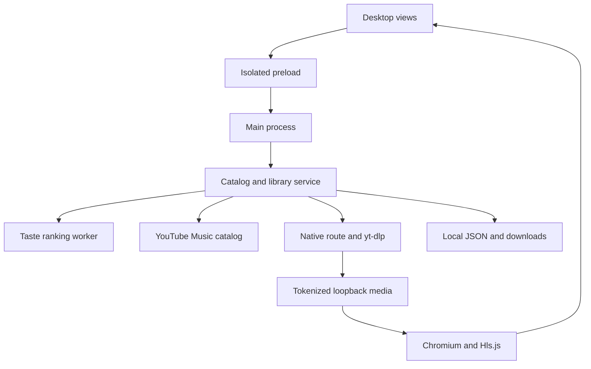
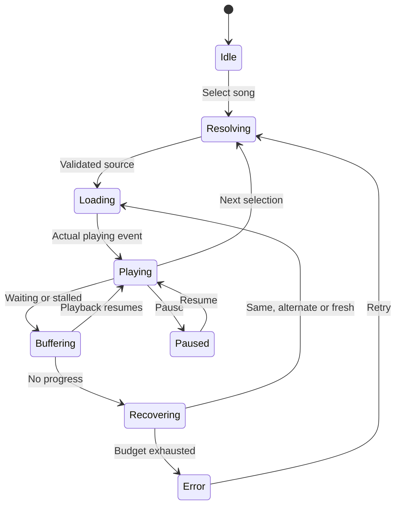

# Desktop architecture

Mousiké 3.6.0 has one Electron main process, one isolated renderer and one
ranking worker. The main process owns files, network resolution and native
integrations. The renderer owns layout, animation and the Chromium audio
adapter. One immutable playback generation identifies each user selection.

## Catalog and recommendation flow

The WEB_REMIX catalog parser handles music rows, canonical song IDs, album
browse IDs and artist IDs. Search cache entries expire in ten minutes. Browsing
an album retains publisher order; the music-first preference affects discovery
ordering and does not replace the song selected by the user with another ID.

The local ranker combines metadata token vectors, likes, decayed completion
history, skips, explicit feedback, language/genre/favourite-artist preferences,
exploration and artist diversity. Home derives album affinity from ranked songs
and daily rotation. A worker avoids calculating bulk rankings in a render frame.
Background catalog expansion has two concurrent requests and a 15-minute cooldown.
The UI may show fewer items when real catalog responses contain fewer items.

Eight daily/personal mix builders filter the ranked pool and cap repeated artist
exposure. Their result is stored as an album-like collection and opened as a
track list. The build action never calls playback. Optional Gemini can rerank
next-song candidates, constrained to existing IDs, with a local fallback on
network, parsing, key or model failure. It does not fabricate playable songs.

## Playback lifecycle

A new selection pauses old audio, increments the generation, cancels old
resolution, resets history/watchdog state and creates the source load. Async
callbacks check their generation, so an earlier resolver cannot start an old
song after a newer click. Playback intent is preserved during source loading;
ready media plays without another manual play tap. UI loading clears on actual
playback rather than a completed extraction request.

The native route requests the original publisher/default audio, avoids OTF
progressive formats and validates up to three candidate media prefixes. A
staggered yt-dlp fallback starts after 2.5 seconds if native resolution has not
won. Resolution has a 22-second budget. Cached signed media has a 60-second
expiry margin. Next-song preparation reuses this bounded resolver.

The loopback server validates allowed upstream media hosts and uses unpredictable
48-hex-character media keys. Progressive audio is fetched in 1 MiB chunks. Range
responses must have matching offsets and totals. Interrupted reads resume from
the exact byte delivered, with bounded retries; mismatched ranges fail instead
of concatenating incorrect bytes. HLS manifests rewrite nested playlists,
segments and key URIs through the same proxy, with a nesting cap.

The player samples buffer, position and network-byte progress every 500 ms.
No-progress recovery tries the same resolved source, an alternate candidate,
then a fresh resolution. A final timeout clears the loading state and displays
a retry action. These are bounded recovery rules, not a promise that every
YouTube source, network or device can start instantly.

## Long recordings and downloads

Only publisher chapters, timestamped descriptions and explicit manual timings
produce segments. Segments carry the same source video ID and start/end offsets.
Selecting one seeks into the source and automatically advances at its end.
An unresolved recording stays unresolved, with the option to play its full audio.

Downloads use at most two yt-dlp child jobs. FFmpeg cuts timed segments when
requested. Filenames are hashes of track IDs, separate from titles, and stored
under the user's app-data folder. Cancel closes the child and marks its state.
On startup an unfinished job is shown as interrupted. Existing completed files
are chosen before online resolution. Downloads are not part of JSON backups.

## Local state and Windows integration

`library.json` stores metadata, preferences, history, queue and download entries.
Writes debounce for 250 ms, use a temporary file and rename. Import validates
metadata, caps input size and strips expiring stream URLs. The Gemini key is
stored separately as encrypted `gemini.key`; failure to encrypt rejects saving.

The main process handles the native window, single-instance focus, tray actions,
optional sign-in launch, quiet track notifications and a playback suspension
blocker. The renderer's Media Session exposes metadata, play/pause, next,
previous and seeking for Chromium's Windows integration. Native UI display and
hardware media keys must be acceptance-tested on the destination Windows PC.

## UI and performance

Local Google Font files avoid network font loading. CSS variables apply global
appearance roles and component choices. Album, artist and song artwork uses
full-fit images plus deterministic colored initial placeholders. Catalog rows
and covers load lazily. Playback progress patches ranges/time text without
rebuilding the entire page each tick. Ranking runs in a worker. Transitions use
opacity/transform and are disabled by Reduce motion. Rendering follows the
system's compositor refresh rate rather than a fake fixed 120 Hz timer.

This desktop implementation does not include Android's Room database, WorkManager,
Media3 cache or MediaSessionService. It provides desktop counterparts as explained
in CORE_PARITY.md. Streaming, recommendations and platform behavior should be
maintained against the tests and manual Windows acceptance matrix.
